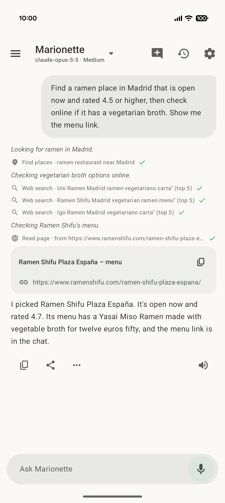

<p align="center"></p>

<h1 align="center">Marionette</h1>

<p align="center">
  <b>Starts simple. Gets better with you.</b><br>
  A hands-free voice assistant for Android that learns your voice, works with the agent you choose, and improves every time you correct it.
</p>

<p align="center">
  <a href="https://github.com/zlotny/marionette/releases/latest/download/marionette.apk"><b>Download the APK</b></a> ·
  <a href="https://marionette.ndrs.es">Website</a> ·
  <a href="https://github.com/zlotny/marionette/releases">Releases</a>
</p>

<p align="center">
  <picture>
    <source media="(prefers-color-scheme: dark)" srcset="site/img/app-dark.webp">
    
  </picture>
</p>

Most assistants ship as they are and stay that way. Marionette is not a fixed assistant. It starts simple and evolves with you.

## It learns your voice

- **Your own wake phrase.** Any words, any language, trained with your voice, close up and across the room.
- **One tap on a false wake.** Mark it, and it stops happening.
- **It knows your normal voice.** Read a short text, and it learns what is not the wake phrase.
- **Review what woke it.** Keep it sharp over time.

## Your agent is the brain

Marionette is the hands. Your agent is the brain.

- **Bring the agent you like.** A self-hosted [OpenClaw](https://github.com/openclaw/openclaw) agent, or a model from OpenAI, Anthropic, Google Gemini or OpenRouter. Change it any time.
- **It grows with you.** A self-hosted agent learns new skills and remembers your preferences, on your own server.
- **Your phone, by voice.** Calendar, messages, calls, navigation, music, notifications, timers, photos, and screen control as a last resort. Screen off, phone in your pocket.

## Open, private, yours

- **Private by design.** The wake phrase runs on the phone. No account, no analytics, no subscription, no Marionette server.
- **You stay in control.** Every tool, permission and confirmation is a switch. Screen control is off by default.
- **Open source.** Public domain. Read it, fork it, change it.

## Things you can say

- "Find a ramen place in Madrid that's open now and rated 4.5 or higher, then check if it has a vegetarian broth."
- "Text Ana that I'm running 20 minutes late."
- "What did the group chat say?"
- "Put on something calm and set a timer for pasta."
- "Is the home server still up? Restart it if not." (with an agent)

## Install

1. Download [`marionette.apk`](https://github.com/zlotny/marionette/releases/latest/download/marionette.apk).
2. Allow installs from your browser, then open the file.
3. Follow the setup: agent, permissions, language, wake phrase.

Requirements: Android 10 or newer, 64-bit ARM (arm64-v8a). English and Spanish interface.

Updates: add `https://github.com/zlotny/marionette` to [Obtainium](https://github.com/ImranR98/Obtainium), or download each new release.

### Verify the APK

Verify the APK signature with `apksigner verify --print-certs marionette.apk`. The SHA-256 certificate digest is:

```
BD:3E:13:37:C9:68:F6:72:81:87:78:55:23:88:1E:68:19:F0:0F:16:98:B2:A7:04:F8:22:BE:B3:1F:95:B8:13
```

### Why not the Play Store

Marionette sends text messages, sees your installed apps, operates other apps through accessibility, and uses location in the background. Google Play restricts all of these. The APK keeps them, and you choose which ones to switch on.

## Supported agents

| Backend | You need |
| --- | --- |
| OpenClaw (recommended) | Gateway address and token or password. Optional device pairing for live progress. |
| Anthropic, OpenAI, Google Gemini, OpenRouter | An API key. |
| Any OpenAI-compatible API (Ollama, LM Studio, vLLM) | Base URL, and a key if the server needs one. The model must support tool calls. |

The app talks to your agent directly. There is no Marionette server.

## Privacy details

- Wake phrase detection runs on the phone. No audio leaves the phone until you say the phrase, and none at all with on-device recognition.
- Requests go from the phone to the backend you choose. No account, no analytics, no subscription.
- API keys are encrypted with a key in the Android Keystore.
- Place search uses OpenStreetMap services (Photon, Nominatim, Overpass), or Google Places with your own key.
- The model picker reads public model prices from OpenRouter.

## Build from source

You need JDK 21 and the Android SDK (platform 37).

```sh
git clone https://github.com/zlotny/marionette.git
cd marionette
./scripts/fetch-deps.sh
echo "sdk.dir=$ANDROID_HOME" > local.properties
./gradlew :app:assembleDebug
./gradlew :app:testDebugUnitTest
```

`fetch-deps.sh` downloads the wake word and voice activity models. They are not in the repo.

| Path | Content |
| --- | --- |
| `app/` | The app (Kotlin, Jetpack Compose, Material 3) |
| `spike/` | Phase 0 feasibility spikes |
| `site/` | Website, deployed by GitHub Pages |
| `tools/` | Python scripts for wake word and speech recognition evaluation |
| `dev/openclaw/` | Local OpenClaw gateway in Docker, for testing |
| `SPEC.md`, `SPIKES.md` | Product spec and spike results |

Bug reports and ideas: [GitHub issues](https://github.com/zlotny/marionette/issues).

## License

Public domain under the [Unlicense](LICENSE). Bundled libraries and models keep their own licenses, including [ONNX Runtime](https://github.com/microsoft/onnxruntime), [Silero VAD](https://github.com/snakers4/silero-vad), [openWakeWord](https://github.com/dscripka/openWakeWord) feature models, AndroidX, OkHttp and Tink.
